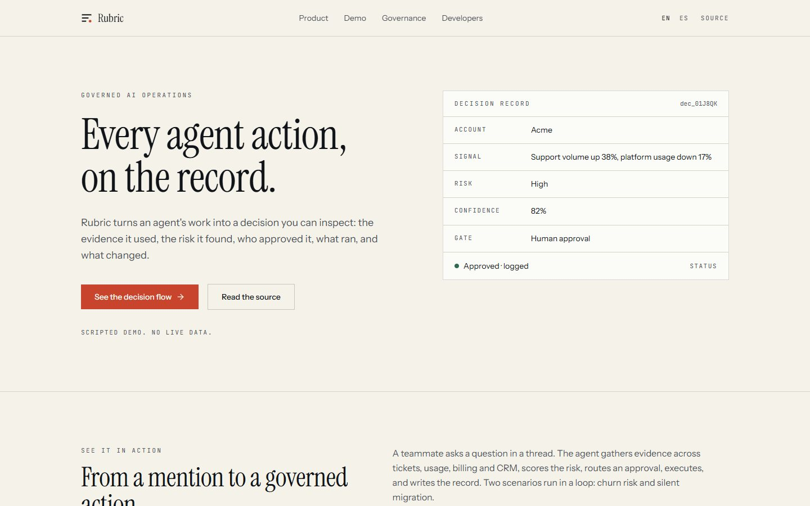
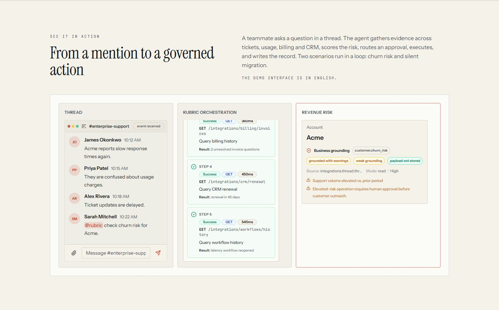

# Rubric

A bilingual marketing site and interactive demo for a governed AI-operations product, built with Next.js 14, TypeScript and Tailwind CSS.



## What it is

Rubric is a product concept: an agent that turns operational requests into inspectable decisions — evidence, risk, a human approval, execution and an audit record. The site explains that model in English and Spanish, and ships a scripted three-panel demo that walks through the whole loop.

It is a front end only. There is no backend, database, authentication or billing, and the demo does not call any live service.

## Why this over a marketing template

- **A working interaction, not a screenshot.** The demo is a real client-side state machine with two scenarios (churn risk and silent migration) that run in a loop, with replay controls, step logs and a risk panel.
- **Two locales, one content source.** Every string lives in `messages/en.json` and `messages/es.json`; routes are statically generated for both.
- **No third-party media.** The brand mark, favicon and Open Graph image are SVG and CSS in this repository. Fonts are self-hosted at build time by `next/font`.
- **Boring to run.** No database, no environment variables, no external API keys. `npm install && npm run dev` is the whole setup.

## Quick start

Requirements: Node.js 20 or newer and npm.

```bash
git clone https://github.com/JORDANROBERTO74/rubric.git
cd rubric
npm install
npm run dev
```

Open <http://localhost:3000>. The middleware redirects `/` to `/en`.

| Command | What it does |
| --- | --- |
| `npm run dev` | Development server on port 3000 |
| `npm run build` | Production build; prerenders `/en` and `/es` |
| `npm run start` | Serves the production build |
| `npm run lint` | ESLint via `next lint` |
| `npm run typecheck` | `tsc --noEmit` |

## The demo



The demo is the centrepiece. A teammate mentions `@rubric` in a channel; the agent resolves the account, queries tickets, billing, usage and CRM, scores the risk, asks for a human approval and executes a bounded action. Every step is written into the same record.

- Two scenarios, `churn` and `migration`, alternate automatically.
- Replay controls, speed toggle and reduced-motion support are built in.
- The interface text of the demo is English by design; the surrounding page is bilingual.

## Project structure

```
src/
  app/[locale]/       layout, page, not-found (en and es)
  app/icon.svg        favicon
  components/
    brand/            Rubric mark
    site/             navigation, hero, sections, footer
    slack-demo/       the scripted decision demo (state machine, scenarios, panels)
    ui/               the shadcn/ui primitives actually used
  i18n/               locale list and next-intl request config
  middleware.ts       locale detection
messages/             en.json, es.json
docs/                 screenshots, OG card source, provenance
```

## Deployment

Any host that runs Next.js works. On Vercel: import the repository, keep the default build command, and deploy — no environment variables are required. Production build output is static for both locales.

Live site: <https://rubric-hq.vercel.app>

## Status and scope

What is real: the layout, both translations, the demo state machine, accessibility basics (skip link, landmark structure, focus states, reduced motion) and the Open Graph image.

What is not built: a backend, a real agent runtime, integrations, accounts, analytics and a contact form. The agent in the demo is scripted and the account (`Acme`) is fictional. The API sample on the page is an illustration, not a published SDK.

## License

MIT. See [LICENSE](./LICENSE). Fonts are Instrument Serif, Instrument Sans and JetBrains Mono, licensed under the SIL Open Font License. Provenance notes are in [docs/compliance/rubric/provenance.md](./docs/compliance/rubric/provenance.md).
